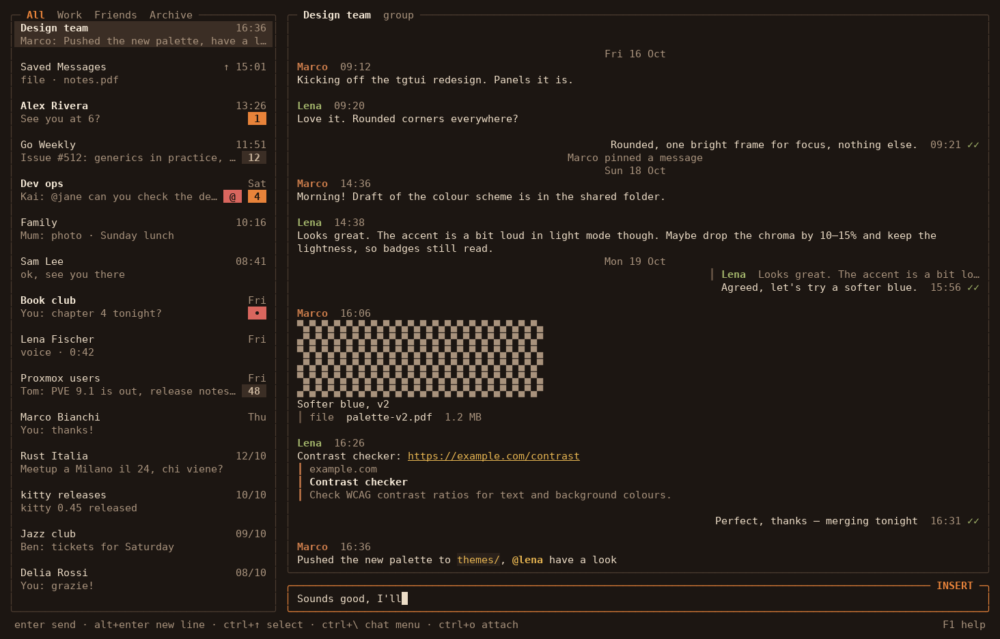
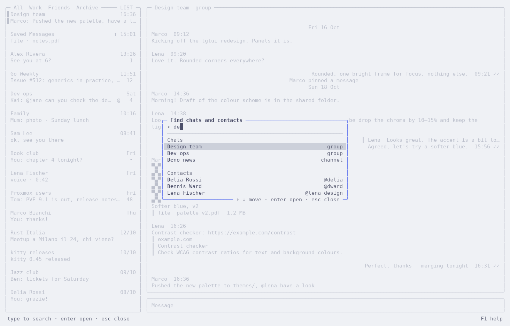
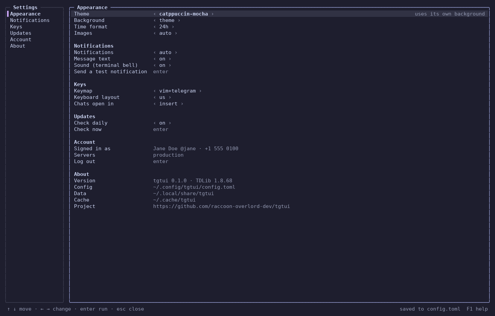
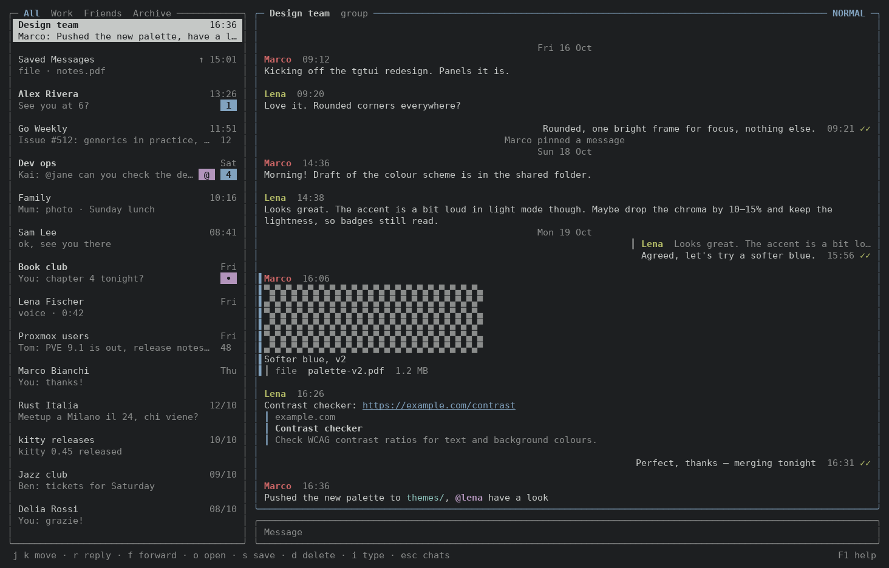

# tgtui

An unofficial Telegram client for the terminal, built on the Telegram API with
[TDLib](https://github.com/tdlib/td). Keyboard first, with Telegram Desktop's shortcuts and an
optional Vim-style normal mode.

tgtui is not affiliated with or endorsed by Telegram.



| | |
|---|---|
|  |  |
|  | |

## Features

- Chat list with folders and the archive, private chats, groups and read-only channels
- Formatted messages (bold, italic, code, links, spoilers, quotes), replies, edits, delete, forward
- Photos and stickers inline (kitty graphics, or coloured half blocks in any terminal),
  sending files and albums, opening and saving attachments
- Search: chats and contacts, messages in all chats or in one chat, `@` mentions
- Start a chat with a contact, an `@username` or a `+phone` number
- Notifications through the terminal (kitty, Ghostty, iTerm2, WezTerm…) or the OS
- Two keymaps: `vim+telegram` (normal mode with letter keys) and `telegram` (no modes),
  US and Italian keyboard layouts
- Themes: `terminal` (your terminal's colours), `catppuccin-mocha`, `catppuccin-latte`,
  `harvest`, `harvest-light`
- Fast: the chat list comes from TDLib's local database before the network answers

## Install

Linux (x86_64 and arm64): a single static binary that runs on any distribution.

```sh
curl -fsSL https://raw.githubusercontent.com/raccoon-overlord-dev/tgtui/main/install.sh | sh
```

The script downloads the latest release for your machine, checks it against the release's
`checksums.txt` and installs it to `~/.local/bin` (`TGTUI_INSTALL_DIR` changes that). Run
it again to update, or update from tgtui: it checks for new releases once a day, and
`U` (or Settings › Install update) installs one; restart tgtui to use it.

To uninstall (it asks before deleting your settings and local session):

```sh
curl -fsSL https://raw.githubusercontent.com/raccoon-overlord-dev/tgtui/main/install.sh | sh -s -- --uninstall
```

You can also download `tgtui_linux_<arch>.tar.gz` from the
[releases](https://github.com/raccoon-overlord-dev/tgtui/releases) yourself. macOS builds
are coming.

## First run

Sign in with your phone number (Telegram sends a code to your other devices) or scan a QR
code from the Telegram app on your phone (Settings › Devices › Link Desktop Device).

Release builds include tgtui's API credentials. To use your own, get an `api_id` and
`api_hash` at [my.telegram.org](https://my.telegram.org) and set `TGTUI_API_ID` /
`TGTUI_API_HASH` in the environment, or `[telegram]` in the config file.

## Keys

`F1` shows every key. The most used ones:

| | vim+telegram | telegram |
|---|---|---|
| Move in the list, open a chat | `j` `k`, `enter` | `↑` `↓`, `enter` |
| Next / previous chat | `J` `K`, `alt+↑` `alt+↓` | `alt+↑` `alt+↓` |
| Folders | `1`–`9`, `[` `]` | `←` `→`, `ctrl+shift+↑` `↓` |
| Find a chat | `/` | type in the list |
| Search messages | `?`, `ctrl+f` | `ctrl+f` |
| New chat | `g n`, `ctrl+n` | `ctrl+n` |
| Settings | `,`, `F2`, `:` then `>` | `F2`, `>` in the list |
| Select a message | `esc` then `j` `k` | `ctrl+↑` `ctrl+↓` |
| Reply, edit, delete, forward | `r` `e` `d` `f` | `alt+r` `alt+e` `alt+d` `alt+f` |
| Open / save a file | `o` `s` | `alt+o` `alt+s` |
| Attach files | `a`, `ctrl+o`, or paste / drop them | `ctrl+o` |
| Chat menu (mute, pin, archive) | `m`, `ctrl+\` | `ctrl+\`, `F3` |
| Quit | `:q`, `ctrl+q` | `ctrl+q` |

Messages use Telegram's markup: `**bold**`, `__italic__`, `~~strike~~`, `||spoiler||`,
`` `code` ``, `[text](url)`. `alt+enter` starts a new line.

## Configuration

Settings (`F2`) change and save `~/.config/tgtui/config.toml`. The file also has a proxy
section (SOCKS5, HTTP, MTProto). Data lives in `~/.local/share/tgtui` (TDLib's database,
encrypted with a key kept in the OS keychain when there is one), caches in
`~/.cache/tgtui`. All three follow the XDG variables.

## Build from source

TDLib is built inside Docker, so Docker is the only requirement:

```sh
make build    # ./tgtui, a static Linux binary (the first build compiles TDLib, ~30 min)
make test     # go vet and go test (needs Go, not TDLib)
```

`BUILD_JOBS` (default 3) sets TDLib's parallel compile jobs; each takes about 1.5 GB of RAM.

## License

[MIT](LICENSE)
